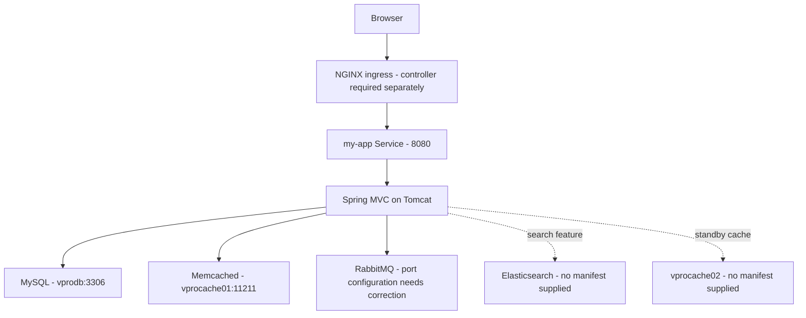

# Application architecture

[Back to README](../README.md) · [Setup](setup.md) · [Pipeline](pipeline.md)

## Request and service flow

[`web.xml`](../src/main/webapp/WEB-INF/web.xml) wires the Spring dispatcher, application context, and security filter. [`appconfig-root.xml`](../src/main/webapp/WEB-INF/appconfig-root.xml) loads MVC, persistence, RabbitMQ, and security configuration, with properties read from `classpath:application.properties`.

## Application features

| Feature | Implementation |
| --- | --- |
| Registration, sign-in, profile pages, and user listing | [`UserController`](../src/main/java/com/visualpathit/account/controller/UserController.java), service/repository classes, and JSP views |
| Persistence | Spring Data JPA and Hibernate, backed by the `accounts` MySQL database |
| Cached user lookup | [`MemcachedUtils`](../src/main/java/com/visualpathit/account/utils/MemcachedUtils.java); active and standby connection settings |
| Messaging demonstration | `/user/rabbit` produces sample messages through the producer service |
| Search demonstration | [`ElasticSearchController`](../src/main/java/com/visualpathit/account/controller/ElasticSearchController.java) and the Elasticsearch transport client |
| Profile image upload | [`FileUploadController`](../src/main/java/com/visualpathit/account/controller/FileUploadController.java); writes under Tomcat's `tmpFiles` directory |

## Kubernetes coverage

All supplied Deployments request one replica. Their namespace is determined by the deployment context; the files do not set one.

| Workload | Service | Container image as checked in |
| --- | --- | --- |
| Application `vproapp` | `my-app`, port `8080` | `vprofile/vprofileapp` |
| Database `vprodb` | `vprodb`, port `3306` | `vprofile/vprofiledb` |
| Cache `vpromc` | `vprocache01`, port `11211` | `memcached` |
| Queue `vpromq01` | `vpromq01`, port `5672` | `rabbitmq` |

The images have no explicit tag or digest in these manifests. Building the local Dockerfile does not update the Deployment's image reference, and this repository does not include the source Dockerfile for the database image.

The [ingress](../kubernetes/vpro-app/vproingress.yaml) expects the `nginx` ingress class and a preconfigured hostname. It supplies no TLS section or ingress controller installation. The app's init containers wait only for the database and cache Service names to resolve in DNS; they do not test application-level readiness.

The [Secret manifest](../kubernetes/vpro-app/app-secret.yml) supplies credentials to the database and queue containers. The app Deployment does not mount that Secret or inject it into the application's property file. Updating the Secret alone therefore does not update application connection credentials.

Read the [setup guide](setup.md) for the RabbitMQ port mismatch, missing data persistence, and other deployment prerequisites before using these examples.
